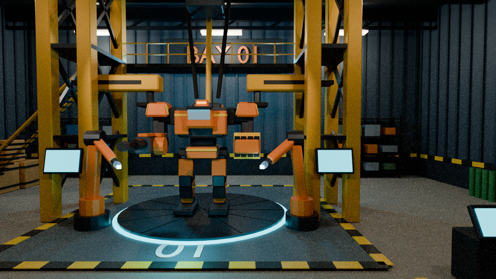
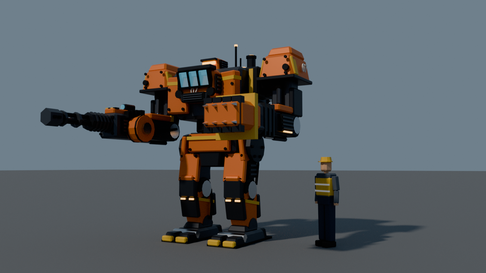
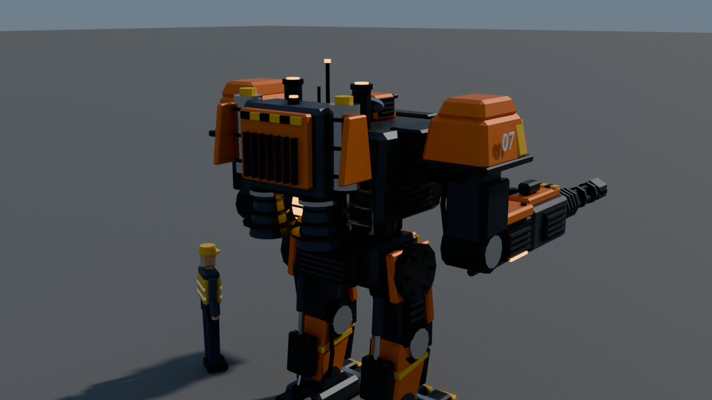
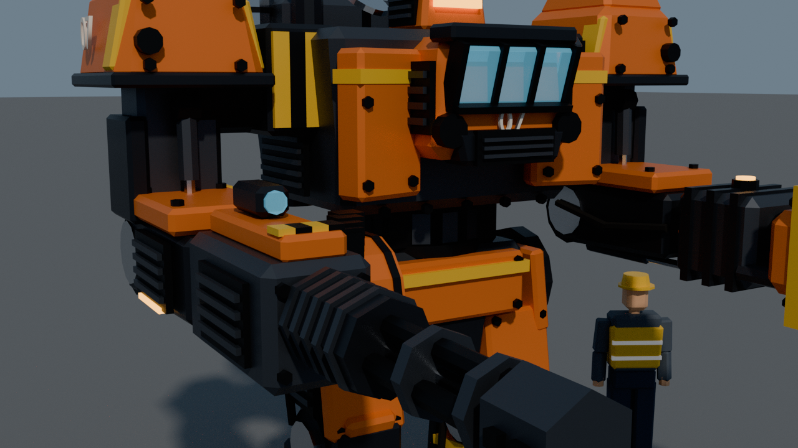

# Mech Workshop

A stylized **first-person mech-building arena fighter**. Your mech is a 15 ft (4.6 m) walker:
the workshop camera sits at human eye level, crew members stand around the dock, and the cockpit
bobs and thuds with every stride. Mechs are built from
modular parts with real physics and per-part damage: armor plates break off,
arms get blown away, and losing the torso ends the fight.

## Game loop

```
        ┌──────────── WORKSHOP ────────────┐
        │ repair damage · equip / buy /    │
        │ sell parts · pick where to go    │
        └───────┬──────────────────┬───────┘
                ▼                  ▼
            ARENA              SALVAGE YARD
   1v1 mech fight for money   search scrap piles for parts
   (damage carries back)      + scrap, sell scrap at the scale
```

## Workshop

Your mech stands in its dock, seen from the front. Options on the right:

- **Upgrades**: pick a slot (or just click that part of the mech), then equip stored parts or buy new ones.
- **Repairs**: per-part damage bars. Repair a single part or everything. Missing armour plates come back.
- **Paint**: colour pickers for primary, secondary, stripes and lights, plus presets.

Each option moves the camera to its own shot. Deploy to the **Arena** or the **Salvage Yard** from the bottom of the panel.

## Controls (in the mech)

| Input | Action |
|---|---|
| W / S | throttle forward / back |
| A / D | turn legs |
| Mouse | twist torso / aim arms |
| LMB / RMB | fire right / left arm weapon |
| Space | jump thruster |
| C | re-centre torso |
| E | interact (salvage, sell, exit) |
| Esc | release / capture mouse |

## Running

Open the folder in **Godot 4.3+** and press Play. Progress saves to `user://save.json`.

## Project layout

```
project.godot            Godot project (autoloads: PartDB, GameState)
scenes/                  main, workshop, arena, salvage_yard
scripts/
  autoload/              part_db.gd (part stats) · game_state.gd (money, loadout, damage, save)
  mech/                  mech.gd (assembly, movement, damage) · weapon.gd
                         player_controller.gd · ai_controller.gd
  levels/                workshop / arena / salvage_yard logic (+ blockouts)
  ui/hud.gd              cockpit HUD
  world/level_utils.gd   lighting, blockout helpers, Blender environment loader
data/parts.json          part stats, generated by the Blender pipeline
assets/models/           .glb exported from Blender (used by the game)
assets/source/           .blend source files
tools/blender/           Blender Python scripts that build every asset
docs/previews/           Blender renders of each asset
```

## Asset pipeline (Blender)

Every model and environment is generated by a Blender script, so assets are
reproducible and editable as code (the `.blend` files are saved too, for hand tweaks).

```bash
sudo apt-get install blender python3-numpy
tools/blender/build_all.sh               # or SKIP_RENDER=1 for models only
```

### Built so far

| Asset | Status |
|---|---|
| Starter mech Mk1: legs, torso, two arms, autocannon, ram fist, missile pod, jump thruster | ✅ |
| Workshop: mech dock bay sized to the mech (clamps, repair arms, turntable, boarding gangway, crew, forklift) | ✅ |
| Human-scale props: workers (4 poses), forklift, traffic cones (`props.py`) | ✅ |
| Salvage yard environment | blockout only |
| Arena environment | blockout only |







### Part conventions

- Each part is one `.glb`, its origin at the mount point; mechs face −Y in Blender (+Z in Godot).
- `socket_*` empties are attachment points (legs → torso → arms → weapons, torso → back).
- `joint_*` empties are pivots the game rotates (torso twist, arm pitch).
- `armor_*` meshes are detachable plates; `weak_point_reactor` takes 2.5× damage.
- `*_collider` boxes become per-part hitboxes.
- Hydraulic pistons are split into a sleeve on the parent joint and a rod on the child joint, so they telescope when the game bends a joint.
- Root extras hold the stats (hp, mass, price, damage, ...), which are exported to `data/parts.json`.
