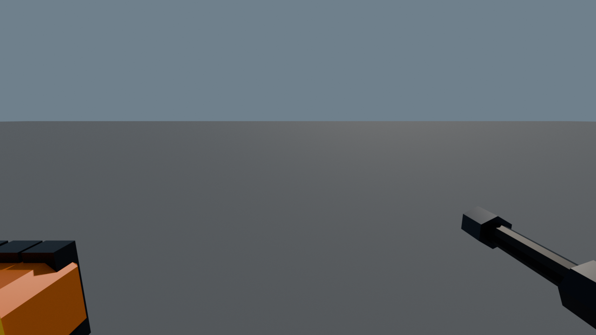

# Mech Workshop

A stylized **first-person mech-building arena fighter**. Mechs are built from
modular parts with real physics and per-part damage: armor plates break off,
arms get blown away, and losing the torso ends the fight.

## Game loop

```
        ┌──────────── WORKSHOP ────────────┐
        │ repair damage · equip / buy /    │
        │ sell parts · pick where to go    │
        └───────┬──────────────────┬───────┘
                ▼                  ▼
            ARENA              SALVAGE YARD
   1v1 mech fight for money   search scrap piles for parts
   (damage carries back)      + scrap, sell scrap at the scale
```

## Controls (in the mech)

| Input | Action |
|---|---|
| W / S | throttle forward / back |
| A / D | turn legs |
| Mouse | twist torso / aim arms |
| LMB / RMB | fire right / left arm weapon |
| Space | jump thruster |
| C | re-centre torso |
| E | interact (salvage, sell, exit) |
| Esc | release / capture mouse |

## Running

Open the folder in **Godot 4.3+** and press Play. Progress saves to `user://save.json`.

## Project layout

```
project.godot            Godot project (autoloads: PartDB, GameState)
scenes/                  main, workshop, arena, salvage_yard
scripts/
  autoload/              part_db.gd (part stats) · game_state.gd (money, loadout, damage, save)
  mech/                  mech.gd (assembly, movement, damage) · weapon.gd
                         player_controller.gd · ai_controller.gd
  levels/                workshop / arena / salvage_yard logic (+ blockouts)
  ui/hud.gd              cockpit HUD
  world/level_utils.gd   lighting, blockout helpers, Blender environment loader
data/parts.json          part stats, generated by the Blender pipeline
assets/models/           .glb exported from Blender (used by the game)
assets/source/           .blend source files
tools/blender/           Blender Python scripts that build every asset
docs/previews/           Blender renders of each asset
```

## Asset pipeline (Blender)

Every model and environment is generated by a Blender script, so assets are
reproducible and editable as code (the `.blend` files are saved too, for hand tweaks).

```bash
sudo apt-get install blender python3-numpy
tools/blender/build_all.sh               # or SKIP_RENDER=1 for models only
```

### Built so far

| Asset | Status |
|---|---|
| Starter mech Mk1: legs, torso, two arms, autocannon, ram fist, missile pod, jump thruster | ✅ |
| Workshop environment | blockout only (in Godot) |
| Salvage yard environment | blockout only |
| Arena environment | blockout only |




### Part conventions

- Each part is one `.glb`, its origin at the mount point; mechs face −Y in Blender (+Z in Godot).
- `socket_*` empties are attachment points (legs → torso → arms → weapons, torso → back).
- `joint_*` empties are pivots the game rotates (torso twist, arm pitch).
- `armor_*` meshes are detachable plates; `weak_point_reactor` takes 2.5× damage.
- `*_collider` boxes become per-part hitboxes.
- Root extras hold the stats (hp, mass, price, damage, ...), which are exported to `data/parts.json`.
