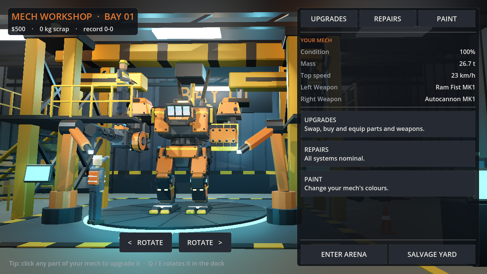
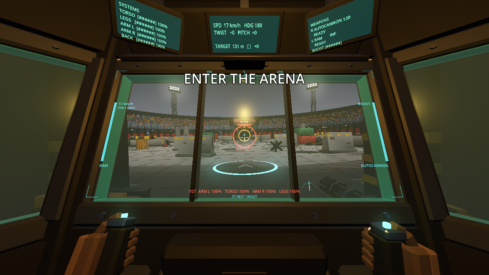
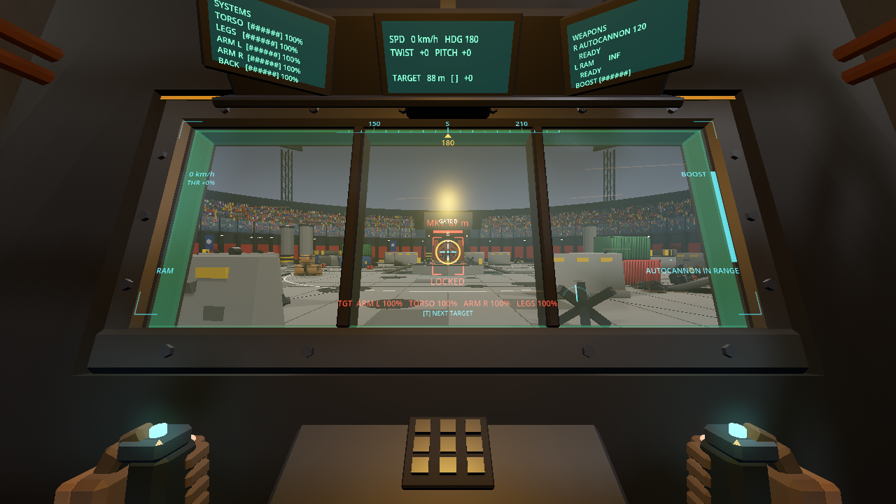
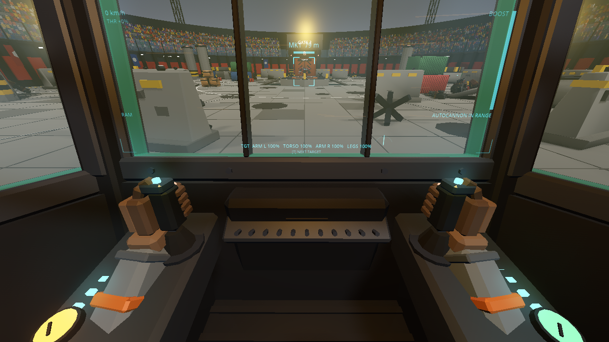
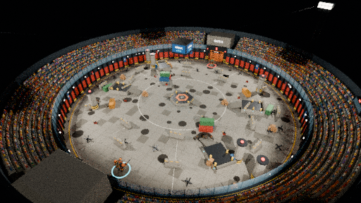
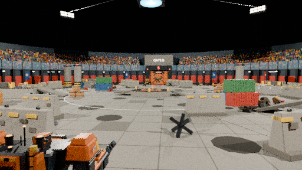

# Mech Workshop

A stylized **first-person mech-building arena fighter**. Your mech is a 15 ft (4.6 m) walker:
the workshop camera sits at human eye level, crew members stand around the dock, and the cockpit
bobs and thuds with every stride. Mechs are built from
modular parts with real physics and per-part damage: armor plates break off,
arms get blown away, and losing the torso ends the fight.

## Game loop

```
        ┌──────────── WORKSHOP ────────────┐
        │ repair damage · equip / buy /    │
        │ sell parts · pick where to go    │
        └───────┬──────────────────┬───────┘
                ▼                  ▼
            ARENA              SALVAGE YARD
   1v1 mech fight for money   search scrap piles for parts
   (damage carries back)      + scrap, sell scrap at the scale
```

## Workshop

Your mech stands in its dock, seen from the front. Options on the right:

- **Upgrades**: pick a slot (or just click that part of the mech), then equip stored parts or buy new ones.
- **Repairs**: per-part damage bars. Repair a single part or everything. Missing armour plates come back.
- **Paint**: colour pickers for primary, secondary, stripes and lights, plus presets.

Hold the **< ROTATE / ROTATE >** buttons under the mech (or Q / E) to spin it on the dock turntable and inspect it from any side. Each option moves the camera to its own shot. Deploy to the **Arena** or the **Salvage Yard** from the bottom of the panel.

## Arena match flow

Both mechs start inside their gate tunnels. The blast doors slide open, each mech walks out to its
spawn mark (you ride along in your cockpit and can look around), the gates slam shut behind
them, then 3-2-1, **FIGHT**. Destroy the enemy torso to win.

## Walking and cockpit

- **Procedural gait** (`scripts/mech/mech_gait.gd`): stride length is capped by what the legs can reach at the
  current crouch, so speed comes from cadence: slow heavy steps when walking, about 2.6 steps/s at full speed.
  Planted feet keep their world position and heading (no sliding, no twisting). The swing peels off heel-first,
  lifts early and lands heel-first. 2-bone IK on the Blender hip/knee/ankle joints never hyperextends, and the
  pistons telescope with them. The body crouches with speed, dips on each footfall, sways and leans. Damaged legs
  limp, turning on the spot re-steps, and stopping squares the feet up.
- **Strafe + legs follow the aim**: A/D sidestep (65 % of forward speed), and the legs turn under the torso to
  face wherever you aim, so they always point forward. Sidesteps use hip roll, so the legs swing out sideways.
- **Views**: V toggles a third-person chase camera, which shows an aim ring, gun crosshair and target bracket and
  pulls in so it doesn't clip into walls. Hold Left Alt to free-look: the camera turns (and orbits in third person)
  while your aim stays put, and the view swings back on release.
- **Idle stance**: when the mech stops, its legs step back to a square forward stance (feet side by side
  under the hips).
- **Holographic HUD + targeting** (`holo_hud.gd`, `targeting.gd`): a cyan hologram projected on the inside of
  the armoured glass (Blender holo plane, rendered live from a SubViewport) that sways with the cockpit.
  It shows a heading tape, gun pipper, aim ring, speed/throttle and boost bars, and weapon readiness and range.
  Targeting brackets the target with range, health and a weak-point marker on its reactor (when visible),
  with an edge arrow when it's off the glass. Hold the guns on a target to lock (0.9 s, needs line of
  sight). A lock makes missiles home, and T cycles targets.
- **Weighted aiming**: the mouse moves an aim point (orange ring on screen); the heavy torso and arms swing
  after it on a damped spring with a top slew speed, and the view and guns (centre "+") catch up a moment
  later. AI mechs aim the same way.
- **Cockpit** (`cockpit_interior_mk1.glb`, built in Blender): a roomy, fully enclosed cabin (80 deg view). You look out through layered armoured glass
  set in a bolted frame. Above the window an overhead bank of three screens angles down at you: systems,
  speed/heading/target, and weapons/boost. Below it, a centre switch panel carries the caution lamps,
  keypad, lamp row and toggles. Two joysticks on side
  consoles sit in the bottom corners of the view, gripped by the pilot's gloved hands (thumb on the hat
  switch, finger on the trigger). The left stick tilts with W/S/A/D and the right with your aim, and the
  hands move with them. Around you: piped side walls and an overhead panel. The glass cracks at
  75 / 50 / 25 % torso integrity. Wraparound glass: angled side windows either side of the main pane give
  peripheral vision (86 deg view).

## Controls (in the mech)

| Input | Action |
|---|---|
| W / S | throttle forward / back |
| A / D | strafe left / right (legs keep facing forward) |
| Mouse | aim torso + arms; the legs turn to follow your aim |
| LMB / RMB | fire right / left arm weapon |
| Space | jump thruster |
| C | re-centre torso |
| T | cycle target |
| V | first / third person |
| Hold Left Alt | free-look (camera only, aim stays put) |
| E | interact (salvage, sell, exit) |
| Esc | release / capture mouse |

## In-engine screenshots






## Playtest builds

```bash
godot --headless --path . --export-release "Windows" build/windows/MechWorkshop.exe
godot --headless --path . --export-release "Linux" build/linux/MechWorkshop.x86_64
godot --headless --path . --export-release "macOS" build/macos/MechWorkshop.zip
```

(`export_presets.cfg` is committed; Godot 4.3 export templates required.) Tests:

```bash
godot --headless --path . res://tests/smoke_test.tscn           # gameplay smoke test
xvfb-run godot --path . res://tests/screenshots.tscn            # in-engine screenshots
```

## Running

Open the folder in **Godot 4.3+** and press Play. Progress saves to `user://save.json`.

## Project layout

```
project.godot            Godot project (autoloads: PartDB, GameState)
scenes/                  main, workshop, arena, salvage_yard
scripts/
  autoload/              part_db.gd (part stats) · game_state.gd (money, loadout, damage, save)
  mech/                  mech.gd (assembly, movement, damage) · weapon.gd
                         player_controller.gd · ai_controller.gd
  levels/                workshop / arena / salvage_yard logic (+ blockouts)
  ui/hud.gd              cockpit HUD
  world/level_utils.gd   lighting, blockout helpers, Blender environment loader
  world/destructible.gd  breakable / explosive props (from Blender extras)
data/parts.json          part stats, generated by the Blender pipeline
assets/models/           .glb exported from Blender (used by the game)
assets/source/           .blend source files
tools/blender/           Blender Python scripts that build every asset
docs/previews/           Blender renders of each asset
```

## Asset pipeline (Blender)

Every model and environment is generated by a Blender script, so assets are
reproducible and editable as code (the `.blend` files are saved too, for hand tweaks).

```bash
sudo apt-get install blender python3-numpy
tools/blender/build_all.sh               # or SKIP_RENDER=1 for models only
```

### Built so far

| Asset | Status |
|---|---|
| Starter mech Mk1: legs, torso, two arms, autocannon, ram fist, missile pod, jump thruster | ✅ |
| Workshop: mech dock bay sized to the mech (clamps, repair arms, turntable, boarding gangway, crew, forklift) | ✅ |
| Testing grounds: firing lanes with distance markers and respawning dummies, patrol dummy, ramps, 2/4/6 m jump blocks, slalom, crates/barrels, tower | ✅ |
| Human-scale props: workers (4 poses), forklift, traffic cones (`props.py`) | ✅ |
| Salvage yard environment | blockout only |
| Arena: 116 m night colosseum: raised decks, three rings of cover, stands with crowd, blast walls + glass, gates A/B with tunnels, floodlight towers, jumbotron, symmetric cover, wrecked mechs, destructible crates, explosive barrels | ✅ |






### Part conventions

- Each part is one `.glb`, its origin at the mount point; mechs face −Y in Blender (+Z in Godot).
- `socket_*` empties are attachment points (legs → torso → arms → weapons, torso → back).
- `joint_*` empties are pivots the game rotates (torso twist, arm pitch).
- `armor_*` meshes are detachable plates; `weak_point_reactor` takes 2.5× damage.
- `*_collider` boxes become per-part hitboxes.
- Hydraulic pistons are split into a sleeve on the parent joint and a rod on the child joint, so they telescope when the game bends a joint.
- Root extras hold the stats (hp, mass, price, damage, ...), which are exported to `data/parts.json`.
